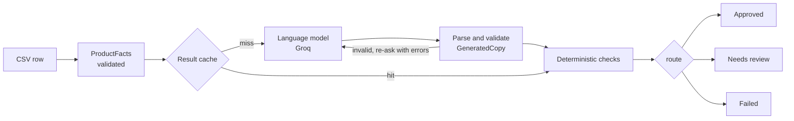

# ListForge

Product copy generation with deterministic validation and human review routing.

A language model writes shop listings from a product catalogue. Code then checks every number, stone, colour, material and place in the text against that product's own row, and routes the result to **approved**, **needs review** or **failed**. Nothing is published automatically.

**Live demo:** [list-forge-lyart.vercel.app](https://list-forge-lyart.vercel.app) (invite only, because every run calls a paid model)

## The idea: the model proposes, code decides

The model is treated as an untrusted source of text. It never decides whether its own output is good enough. Everything after the model call is plain, tested code: parse the reply, validate its shape, compare its claims with the facts, then route it. Anything doubtful reaches a person with the evidence highlighted in place.

This is the same architecture as a medical intake OCR pipeline I built earlier. There, model output never wrote to a patient record on its own: deterministic rules decided what was accepted, and everything else went to a reviewer who saw the scan beside the machine's reading. Here the evidence is the product row beside the generated copy.

The parallel breaks in useful places, and the design follows from where it breaks:

- **Copy has no single right answer.** The checks test faithfulness to the input, not correctness. Tone stays a human judgement.
- **Language models have no calibrated confidence.** So the model is never asked to grade itself, and there is no second model acting as a judge.
- **The errors point the other way.** OCR mostly misreads what is there. Language models add things nobody supplied: an origin, a bead count, a health benefit. The checks look for exactly that.

## How one product flows



A cache hit skips the model call but still runs the checks, so a stricter check re-grades old output for free.

## What gets flagged

| Check | Flags | Severity |
|---|---|---|
| Numbers | A count, size, weight or price not in the row. `24.90` and `24.9` compare equal | warn |
| Entities | A stone, colour or material from the vocabulary that the row does not list, including plurals and spelling variants | warn |
| Origin | A country or region, or its adjective, that the row does not give | warn |
| Claims | Patterns each brand forbids, such as heals, cures or relieves anxiety | block |
| Absence | Sentences describing missing data, such as "origin not specified" | warn |

Each finding carries the field and character offsets, so the review screen highlights the exact span with the rule that caught it.

## Results

| Measure | Result |
|---|---|
| Planted violations caught (hand-written fixtures) | 14 of 14 |
| Clean copy wrongly flagged (hand-written fixtures) | 0 of 6 |
| Dev catalogue, 5 products, Mindful Souls, `gpt-oss-20b` | 4 approved, 1 needs review (an invented colour) |
| The same batch run again | 5 cache hits, $0.0000 spent, $0.0006 saved at list price |
| Automated tests | 281 backend, 139 frontend |

The fixture set is small and written by me, so read it as a regression suite rather than a benchmark. The concurrency setting and the `copy-v1` against `copy-v2` comparison have not been measured yet; `list-forge compare` produces the second one.

## Design decisions

**No structured outputs.** The model is asked for JSON, the reply is parsed and validated with Pydantic, and a failure is sent back with the exact validation errors. Structured outputs guarantee shape, not truth, so the validation layer has to exist anyway, and this approach works on any OpenAI-compatible endpoint.

**No model as judge.** The checks are deterministic, free, fast and tested with a table of cases. A judge model would be one more probabilistic component on the wrong side of the boundary.

**Two retry loops with different jobs.** Transport failures (connection errors, 429, 5xx) back off exponentially with full jitter and honour `retry-after`. Content failures re-ask with the errors, on a separate small budget. Client errors are never retried, and a rejected key aborts the whole batch instead of failing every row the same way.

**One semaphore per process.** Batches and regenerations share it, so a second batch cannot double the calls in flight. A semaphore limits concurrency, not rate: 429s are absorbed by backoff. A token bucket fed by the provider's rate limit headers is the next step.

**Cache the generation, not the verdict.** The key is a hash of the product facts, the brand and the prompt fingerprint, so changing any of them simply stops matching old entries. Checks re-run on every hit. Failures are never cached, and Regenerate bypasses the lookup.

**Prompt versions are data.** Each version is registered and never edited in place. A fingerprint hashes the rendered prompt with the sampling parameters, and every item records its prompt version, fingerprint, model, attempts, tokens, cost and whether it came from cache.

**Types from end to end.** Pydantic validates every boundary: environment, CSV, TOML, model output, HTTP and database rows. The frontend's TypeScript types are generated from the API's OpenAPI schema. Money is `Decimal` and travels as a string.

**Small infrastructure on purpose.** SQLite and in-process background tasks are enough for a demo. On restart, items left in flight are marked failed and can be regenerated. Production would use Postgres and a durable queue.

**Access codes are cost control, not authentication.** Each recipient gets their own code with a daily run limit, requests are rate limited per IP, and uploads are capped in rows. Only the two endpoints that call the model are gated.

**No framework for the model call.** It is one request per product followed by deterministic checks. A framework would add indirection and hide the retry and parsing behaviour this project exists to show.

## Known limitations

- The absence check misses some phrasings of "this fact is unknown".
- Colour words that are also other things (gold, rose, clear) are only flagged in colour phrasing, so some invented colours pass.
- Numbers written as words are not checked.
- The checks only know their vocabulary. Soft claims that avoid banned words, such as "supports emotional balance", pass.
- Provider prompt caching hits inconsistently and has not been measured.
- Daily run limits and the per-IP limiter live in memory, so a restart resets them.
- The API allows one frontend origin, so Vercel preview deployments cannot call it.

## Running it locally

Requirements: [uv](https://docs.astral.sh/uv/), Node 20.9 or newer, and a [Groq](https://console.groq.com) API key.

**Backend**

```bash
cd backend
uv sync
cp .env.example .env        # PowerShell: Copy-Item .env.example .env
```

Put your key in `backend/.env` as `GROQ_API_KEY`, then:

```bash
uv run list-forge check
uv run uvicorn list_forge.api:app --reload --port 8000
```

The same pipeline runs from the command line:

```bash
uv run list-forge run ../data/products.dev.csv --brand mindful-souls
uv run list-forge compare ../data/products.dev.csv --brand mindful-souls
```

**Frontend**

```bash
cd frontend
npm ci
npm run dev
```

Set `NEXT_PUBLIC_API_URL=http://localhost:8000` in `frontend/.env.local`, then open http://localhost:3000.

**Tests**

```bash
cd backend && uv run ruff check . && uv run pytest
cd frontend && npm run lint && npm test
```

## Configuration

Backend settings come from the environment or `backend/.env`.

| Variable | Default | Purpose |
|---|---|---|
| `GROQ_API_KEY` | none | Provider key, required |
| `LLM_MODEL` | `openai/gpt-oss-20b` | Model id |
| `PROMPT_VERSION` | `copy-v1` | Registered prompt version to use |
| `MAX_CONCURRENCY` | `3` | Model calls in flight per process |
| `FRONTEND_ORIGIN` | `http://localhost:3000` | Allowed CORS origin, without a trailing slash |
| `DEMO_CODES` | none | `code:label` or `code:label:runs`, comma separated. Unset means open |
| `DEMO_DAILY_BATCHES_PER_CODE` | none | Default daily runs per code |
| `DEMO_MAX_ROWS` | none | Maximum rows per upload |
| `REQUESTS_PER_MINUTE_PER_IP` | none | Rate limit on endpoints that call the model |

## Deployment

Every push to `main` runs the backend and frontend checks. When they pass, GitHub Actions builds the API image, publishes it to the GitHub Container Registry and restarts it on a VPS over SSH, where Caddy terminates TLS. Vercel builds the frontend from the same push. The provider key exists only on the server.

## Project layout

```
backend/
  src/list_forge/   config, models, catalogue, brands, prompts, llm, checks,
                    vocabulary, routing, pipeline, cache, store, access,
                    budgets, ratelimit, services, api, cli
  brands/           one TOML file per brand, plus the shared vocabulary
  tests/            unit, API and fixture-based tests
frontend/           Next.js app: landing page, tool, legal pages
deploy/             Compose stack and Caddy configuration for the server
data/               sample catalogue
```

## How it was built

I planned the system before writing code: the trust boundary, the module boundaries, the check rules and the routing policy. I then built it in phases with an AI coding assistant, Claude Code. Each phase ended with the linter clean, the full test suite passing and a real batch run against the model. One phase was evaluated separately and failed on five defects, which were fixed before the next phase started.

## Disclaimer

This project is not affiliated with, authorised by or endorsed by Foxelli Group. Brand names
appear only to demonstrate how per-brand configuration drives the output. Brand voice
descriptions are inferred from public storefronts and are not official brand guidelines. The
product rows in `data/` are sample data created for this demo, not company data. No brand
assets, logos or published product copy are included in this repository.
